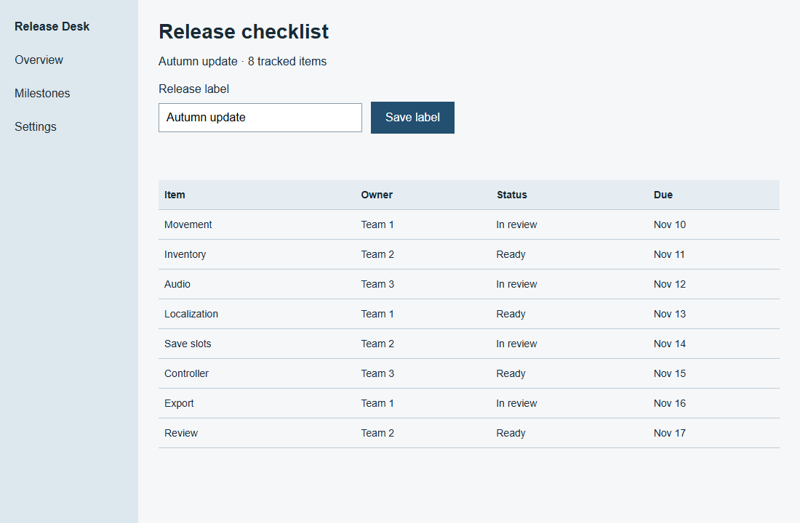
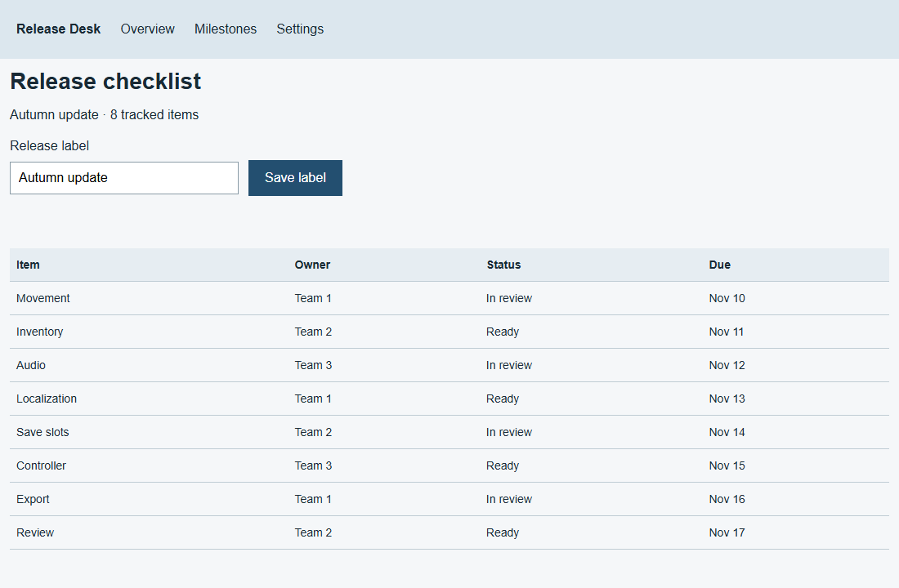
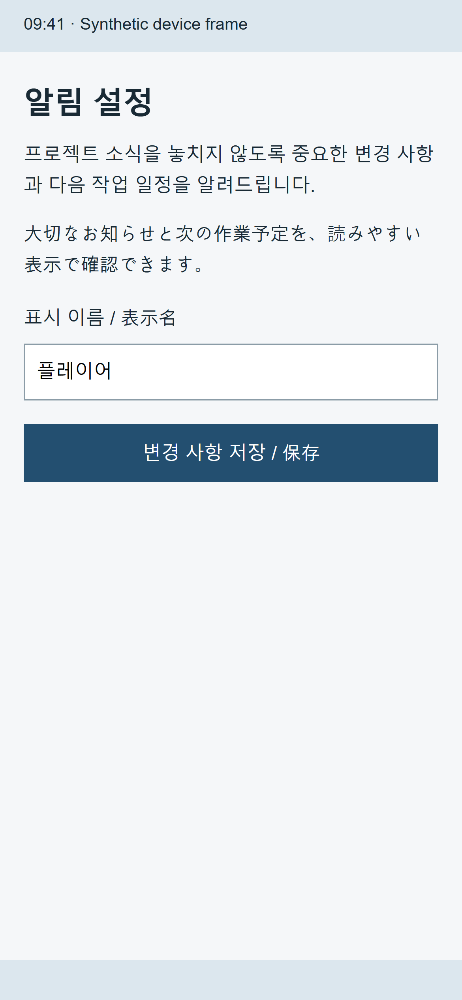
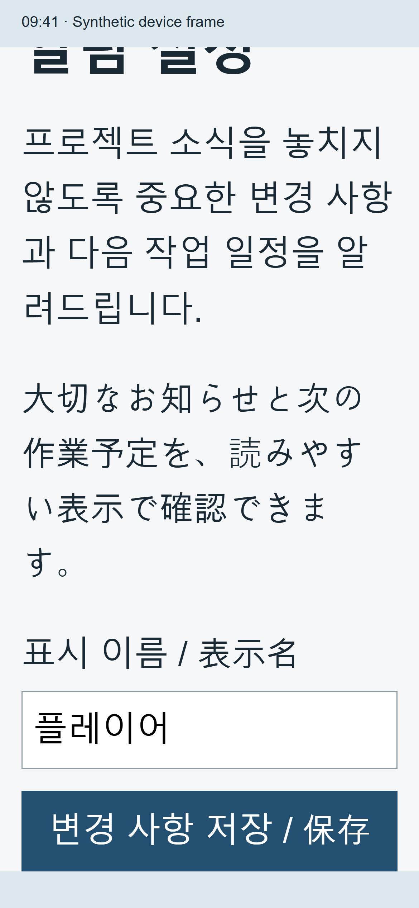
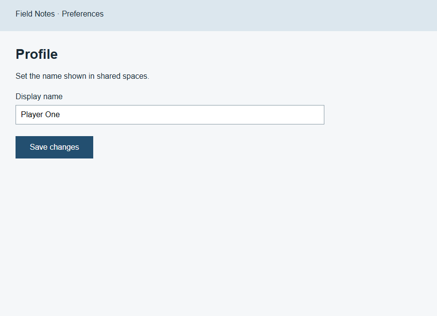
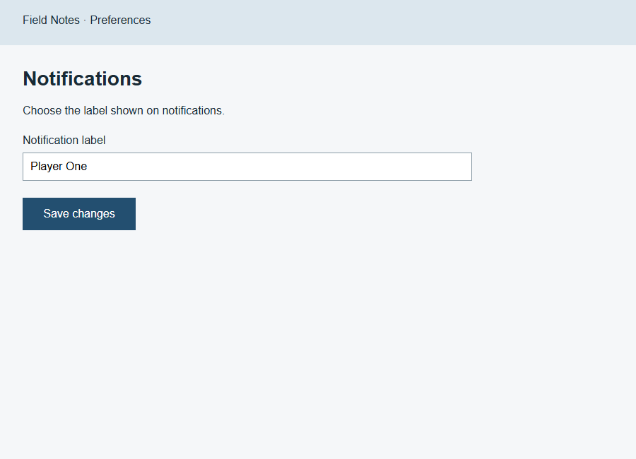
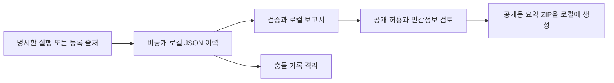

# PRD Screen Fidelity

[English](README.md) | [한국어](README.ko.md)

**기획서의 시안을 기준으로 앱 화면을 구현하거나 비교하고, 요구된 기능도 확인하는 AI 에이전트 스킬입니다.**

사용자가 와이어프레임·참고 이미지·변경 대상이라고 명시하지 않았다면, 예시화면을 실제 디자인 기준으로 취급합니다. 원본 이미지를 직접 확인하고, 화면 요소와 기능을 연결하고, 구현 후 실제 실행 화면과 비교합니다.

이 저장소에는 에이전트용 지침과 선택적 비공개 이력 CLI가 들어 있습니다. 이미지 한 장으로 앱을 자동 생성하는 프로그램이나 완벽한 픽셀 일치를 보장하는 도구는 아닙니다. 화면 작업에는 에이전트가 사용할 수 있는 개발·브라우저·기기 도구를 사용합니다.

[설치](#설치) · [사용 예시](#사용-예시) · [화면 예제](#화면-예제) · [비공개 이력](#선택적-비공개-사용-이력) · [검증 결과](evals/runs/2026-11-09-history/RESULTS.ko.md)

## 화면 예제

아래는 **유지보수자가 만든 합성 예제 3개**의 실제 브라우저 캡처입니다. 같은 작성자가 시안과 수정 스크립트를 만들었으므로 작업 방식을 보여 주는 예시이며, 모델 성능의 독립 비교 결과는 아닙니다. 그림을 누르면 원본 크기로 볼 수 있습니다.

### 제공된 시안의 구조 맞추기

| 기준 시안 | 수정 전 | 수정 후 |
|---|---|---|
| <a href="evals/fixtures/dense-desktop/reference.png"></a> | <a href="evals/runs/2026-11-09-visual-03/dense-desktop-before.png"></a> | <a href="evals/runs/2026-11-09-visual-03/dense-desktop-final.png"></a> |

**1100×720 CSS 픽셀**에서 표의 내용·순서를 유지하며 왼쪽 메뉴와 본문 여백을 복원했습니다. 제목·입력창·버튼·본문 영역의 위치와 크기를 검사했고, 릴리스 이름이 저장 후 새로고침에도 유지되는지 확인했습니다. 그림은 외형을 보여 주며 실제 동작은 [실행 기록](evals/runs/2026-11-09-visual-03/run-results.json)에 별도로 남깁니다. 같은 예제의 [PDF 시안](evals/fixtures/dense-desktop/reference.pdf)과 [렌더링한 페이지](evals/runs/2026-11-09-visual-03/pdf-page-1.png)도 제공합니다.

### 글자를 키워도 읽고 조작할 수 있게 하기

| 기본 글자 크기 | 글자 200% 확대 후 저장 버튼까지 스크롤 |
|---|---|
| <a href="evals/runs/2026-11-09-visual-03/mobile-language-final.png"></a> | <a href="evals/runs/2026-11-09-visual-03/mobile-large-bottom.png"></a> |

두 캡처 모두 **논리 화면 390×844, DPR 3**으로 이미지 크기는 1170×2532입니다. 한국어·일본어 문장이 줄바꿈되고, 확대 상태에서는 스크롤해 저장 버튼에 접근할 수 있습니다. 오른쪽 제목 일부가 위로 올라간 것은 스크롤 상태 차이이며 두 그림을 픽셀 일치 비교로 제시하지 않습니다. 상단 44·하단 34픽셀은 이 합성 예제의 치수로, 모든 기기에 적용하는 시스템 바 높이가 아닙니다. 초기 기하 검사가 놓친 하단 영역 겹침을 이미지 열람으로 발견했고, 수정 후 스크롤 검사와 캡처를 추가했습니다.

### 공통 스타일을 쓰는 다른 화면도 확인하기

| 공통 스타일 수정 후 프로필 | 같은 수정 후 알림 설정 |
|---|---|
| <a href="evals/runs/2026-11-09-visual-03/shared-style-final.png"></a> | <a href="evals/runs/2026-11-09-visual-03/notifications-final.png"></a> |

입력창·버튼의 공통 스타일을 바꾼 뒤 **900×650 화면 두 개를 마지막 수정 이후에 다시 확인**했습니다. 각 화면의 저장·새로고침도 검사했습니다. 확인 범위는 이 두 화면이며 앱 전체 검증을 뜻하지 않습니다. [이미지 열람 기록](evals/runs/2026-11-09-visual-03/image-review.json)과 [상세 결과·한계](evals/runs/2026-11-09-history/RESULTS.ko.md)를 함께 제공합니다.

## 작업 방식

1. 구현·비교 전용·범위가 정해진 재디자인 요청을 구분합니다. 명확한 요청을 매번 재확인하지 않습니다.
2. 원본을 직접 보고 버전·화면 영역·상태를 확인합니다. 작은 국소 변경은 기준 시안·변경 영역·관련 동작·확인 조건만 간단히 기록합니다. 단일 화면이어도 상태가 복잡하거나 공통 컴포넌트를 바꾸면 확장된 화면 계약의 필요한 항목을 사용합니다.
3. 구현 요청일 때만 기존 기술 환경과 지정된 디자인을 유지하며 수정합니다. 비교 전용이면 앱을 수정하지 않고 차이를 보고합니다. 재디자인은 요청된 부분을 바꾸고 유지할 부분에 원본 기준을 적용합니다.
4. 같은 크기·상태에서 원본과 실행 이미지를 직접 확인합니다. 큰 구조부터 세부 표현 순서로 수정하고, 마지막 수정 후 다시 렌더링합니다. 공통 스타일 변경은 대표 사용 화면도 재확인합니다.
5. 시각 비교 수행 여부·시각 결과·기능 결과를 나눠 보고합니다. 미검증 상태·대체 에셋·남은 차이·차단 원인을 드러냅니다.

작은 수정에 별도 계획 파일이나 전체 계약 표를 요구하지 않습니다. 여러 화면·상태는 짧은 확인 목록으로 관리할 수 있습니다. 2~3회 수정 후의 점검은 강제 종료 기준이 아닙니다. 개선이 멈췄다면 원인을 다시 확인하고, 범위·예산 안에서 해결 가능한 중대한 차이는 계속 수정합니다. 반복 횟수가 쌓였다는 이유로 차이를 승인 처리하지 않습니다.

더미 앱에서 버튼을 누르면 메시지만 나오도록 명시한 경우 그 요구를 따릅니다. 실제 저장이 필요한 제품에서 단순 메시지로 기능을 대신하는 것은 허용하지 않습니다.

## Claude Code·Gemini CLI에서도 사용하기

핵심은 공통 `SKILL.md`와 상대경로 참조 문서입니다. `agents/openai.yaml`은 Codex 표시용 부가 정보이며 다른 도구에서 실행하는 데 필요하지 않습니다.

| 도구 | 개인 설치 위치 | 호출 |
|---|---|---|
| Codex | 아래 설명의 현재 인식 경로 | `$prd-screen-fidelity` |
| Claude Code | `~/.claude/skills/prd-screen-fidelity` | `/prd-screen-fidelity` |
| Gemini CLI | `~/.gemini/skills/prd-screen-fidelity` | “prd-screen-fidelity 스킬을 활성화해서 작업해줘” |

Claude Code 설치:

```sh
git clone https://github.com/Ddrubok/prd-screen-fidelity.git ~/.claude/skills/prd-screen-fidelity
```

Gemini CLI 설치:

```sh
gemini skills install https://github.com/Ddrubok/prd-screen-fidelity --scope user
gemini skills list
```

프로젝트 전용이면 Claude는 `.claude/skills/prd-screen-fidelity`, Gemini는 `--scope workspace`를 사용합니다. 설치·활성화 동의가 표시될 수 있습니다. 이후의 `$prd-screen-fidelity` 호출 예시는 Codex용이며 다른 도구에서는 위 호출 방식으로 바꾸세요.

확인 범위는 **CLI 환경**입니다. 일반 웹 채팅, Claude 웹 업로드, Antigravity/agy의 자동 로딩까지 검증한 것은 아닙니다. [호환성 확인 기록](COMPATIBILITY.md)을 참고하세요.

## 설치

에이전트가 인식하는 스킬 위치 한 곳에 설치하세요.

```sh
git clone https://github.com/Ddrubok/prd-screen-fidelity.git ~/.agents/skills/prd-screen-fidelity
```

프로젝트 전용은 `<프로젝트>/.agents/skills/prd-screen-fidelity`을 사용합니다. 현재 환경이 `~/.codex/skills`에서 스킬을 인식한다면 그 위치를 사용해도 됩니다. 중복 설치를 피하고 목록에 없으면 세션을 다시 시작하세요.

## 사용 예시

```text
$prd-screen-fidelity 이 기획서의 예시화면과 기능을 함께 구현해줘.
임의로 UI를 재디자인하지 말고, 같은 화면 크기에서 실제 앱을
시안과 비교해 차이도 수정해줘.
```

```text
$prd-screen-fidelity 현재 앱 화면을 기획서 6페이지와 비교해줘.
이번에는 차이만 보고하고 코드는 수정하지 마.
```

기획서·이미지와 프로젝트 위치를 함께 제공하세요. 원본 폰트·에셋, 대상 화면 크기, 상태별 시안이 있으면 더 정확히 비교할 수 있습니다.

## 확인 범위

- 빌드 성공만으로 시안과 같다고 판단하지 않습니다. 실행할 수 없으면 시각 검증 대기로 표시합니다.
- 이미지 픽셀과 CSS 픽셀을 구분하고 배율·잘라내기·스크롤·내용·폰트를 맞춥니다.
- PDF를 직접 볼 수 없으면 설치된 도구로 필요한 페이지를 렌더링할 수 있지만, 생성된 이미지를 실제로 열어야 시각 확인입니다. PDF DPI를 앱 DPR로 보지 않습니다. 같은 앱 영역을 비교하며 시스템 바 높이를 고정값으로 빼거나 안전 영역을 무조건 잘라내지 않습니다.
- 픽셀 차이 수치를 지각적 유사도나 합격률로 표현하지 않습니다.
- 비교 완료는 두 이미지를 확인했다는 뜻이며 합격을 뜻하지 않습니다. 화면이 같아도 필수 기능이 실패하면 구현 완료가 아니고, 마지막 수정 후 확인하지 못했다면 검증 대기입니다.
- 데스크톱 시안만 있을 때 모바일 화면은 추정한 부분을 명시합니다.
- 접근성과 실제 동작을 유지하고, 원본과 충돌하면 필요한 최소 변경을 설명합니다.
- 사용자가 재디자인을 요청하면 그 요청을 우선합니다. 원본에 있는 스타일을 AI slop이라는 이유로 임의 제거하지 않습니다.

## 로컬 데모 검증

별도 HTML/CSS 시안을 먼저 고정하고 Flutter Web 더미 앱으로 구현한 데모를 수행했습니다. 390×844·430×900 화면을 비교했고 Chromium에서 안내 메시지 버튼 18개를 확인했습니다.

동일 작성자의 데모이므로 스킬 효과의 독립 비교나 Android/iOS 실기기 검증은 아닙니다. 데모 프로젝트·스크린샷·Windows 폰트는 이 저장소에 포함하지 않습니다.

별도의 [2026-10-20 웹 예제](evals/2026-10-20/RESULTS.md)는 V01 왼쪽 메뉴, V08 저장·복원, V12 비교 중 파일 보존을 확인했습니다. [2026-11-09 개발 결과](evals/runs/2026-11-09-history/RESULTS.ko.md)에는 이력 도구 검사와 새 이미지 예제 3개, V04·V15·V16·V18·V10의 실행 근거를 추가했습니다. 동일 작성자의 검사이며 스킬의 정확도·속도 향상을 입증하지 않습니다. 독립 모델 18세션 비교는 미실행입니다.

## 선택적 비공개 사용 이력

`2026.11.09-history.1` 버전에는 Python 3.10 이상 표준 라이브러리만 사용하는 CLI가 추가되었습니다. 앱·스킬 밖에 JSON 리비전을 보관하고, 화면·기능·납품 결과를 구분해 검증합니다. 등록한 자료 가져오기, 중복·충돌 처리, Markdown 보고서, 재생성 가능한 SQLite 인덱스와 검토 후 내보내기를 제공합니다. 설치만으로 수집이 켜지지 않습니다.



이 선택적 경로는 앱·설치된 스킬 밖에서 동작합니다. 충돌한 두 버전은 검토할 수 있게 보존합니다. 내보내기는 로컬 파일 생성이며 게시·전송은 별도 작업입니다. 수집을 꺼도 원래의 화면 작업을 계속할 수 있습니다.

| 근거 | 확인할 수 있는 범위 |
|---|---|
| Windows 이력 검사 34개 통과 | 검사한 기록·병합·비공개 처리·복구 동작 |
| 렌더링하고 직접 본 이미지 예제 3개 | 위에 명시한 화면·상태·관련 기능 |
| 독립 모델 비교·Unix·실기기 | 미실행. 전반적인 효과·호환성을 입증하지 않음 |

```powershell
py -3 scripts/psf_history.py --history-root "$HOME/prd-screen-fidelity-history" init --mode local
py -3 scripts/psf_history.py --history-root "$HOME/prd-screen-fidelity-history" --json start --project example --task compare
py -3 scripts/psf_history.py --history-root "$HOME/prd-screen-fidelity-history" report
py -3 -m unittest discover -s tests/history -v
```

`py -3`이 없으면 설치된 Python 3 실행 파일을 사용하세요. 공통 옵션은 명령 앞에 둡니다. 기본 경로는 `PSF_HISTORY_HOME` 또는 `~/prd-screen-fidelity-history`이며 프로젝트·스킬 밖을 사용합니다. `init`의 기본 모드는 OFF이고, 첨부 수집은 `--allow-evidence`로 별도 설정합니다. 선택적 동기화는 지정한 비공개 폴더에만 실행합니다.

기록 형식 통과, 프로세스 종료 코드 0, 문서의 스킬명 언급, 제출자의 성공 주장은 앱 합격이나 실제 스킬 사용을 증명하지 않습니다. [전체 명령·보관 정책(영문)](references/usage-history.md), [기록 규격](schemas/usage-record.schema.json), [제출 양식(영문)](assets/submission-template.md)을 참고하세요. 공개 내보내기는 공개 허용·민감정보 검토 후 제한된 필드의 로컬 ZIP만 만들며 업로드하지 않습니다.

실제 이력은 저장소 밖에 보관합니다. 파일럿은 확인된 프로젝트 1개의 파일 4개만 읽었고, 과거 자료 1건을 실행 단위·활성화·버전 미상으로 기록했습니다. 실제 사용 실적에 추가한 건수는 **0건**입니다. Windows CLI는 검증했으며 Unix·실기기·호스트별 기록 자동화·독립 모델 비교는 미검증입니다.

## 주요 파일

- [스킬 본문](SKILL.md)
- [화면 계약과 비교 절차](references/contract-and-comparison.md)
- [유지보수 평가 사례 18개와 결과 형식](references/evaluation.md): 스킬 수정·평가 때만 읽으며 일반 화면 작업에서는 불러오지 않습니다. 실행 결과와 NOT RUN 사례를 구분합니다.
- [표시 이름과 호출 예시](agents/openai.yaml)
