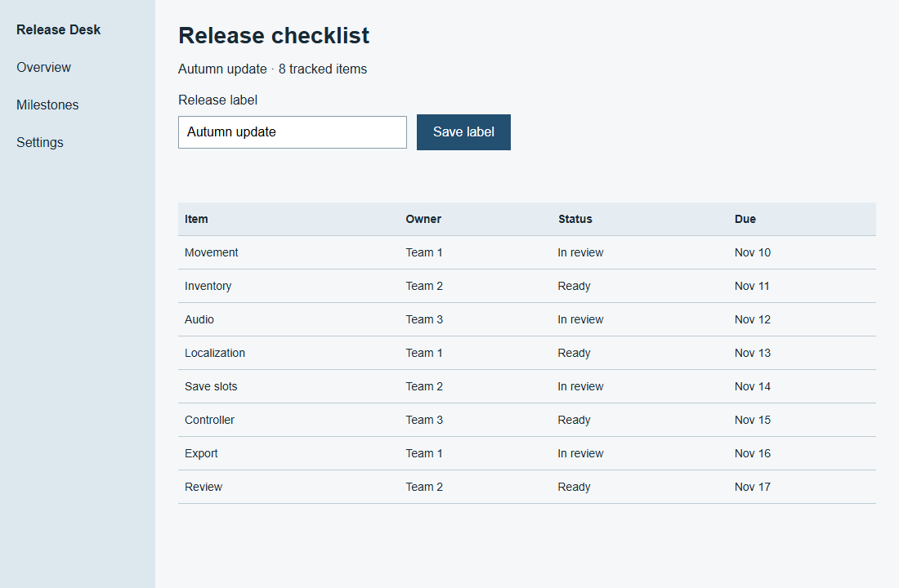
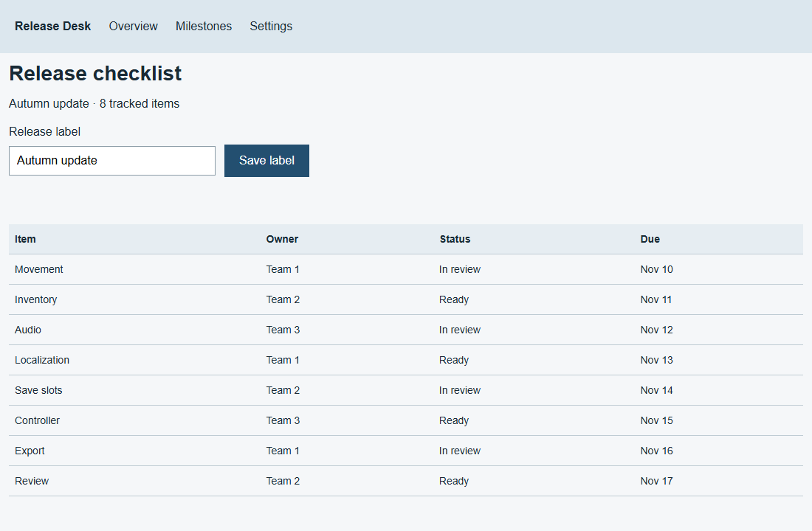
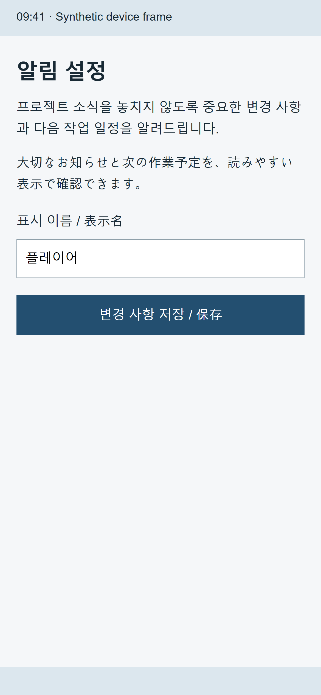
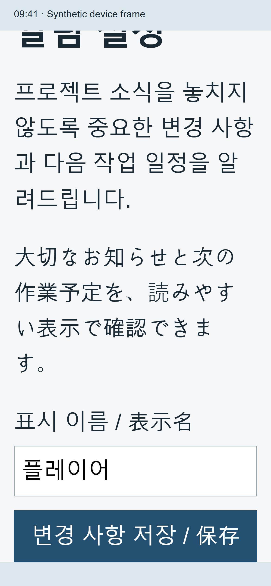
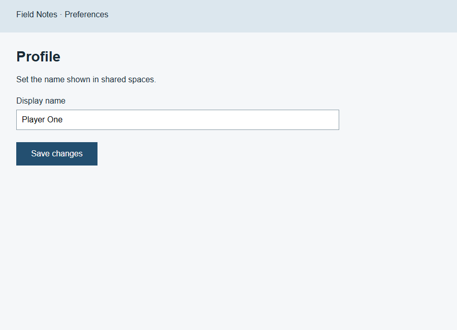
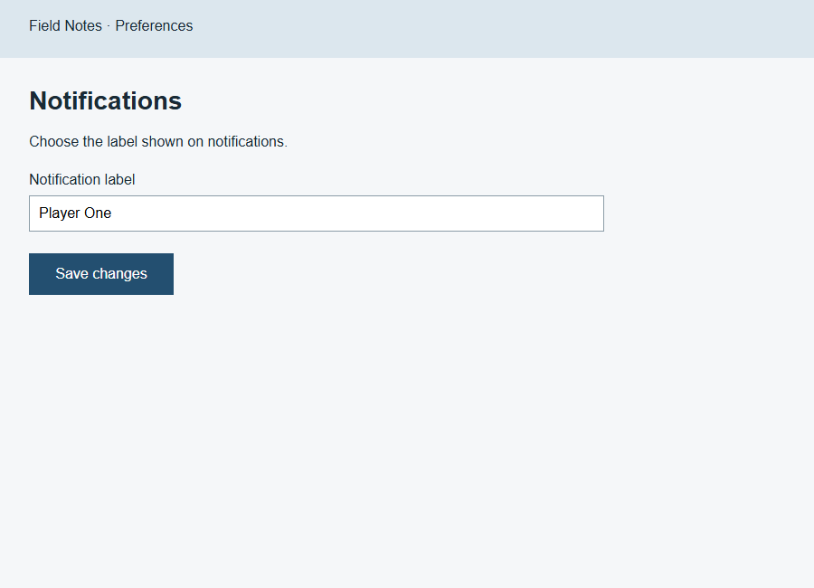
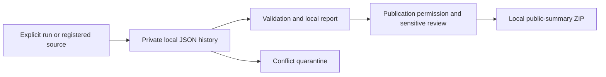

# PRD Screen Fidelity

[English](README.md) | [한국어](README.ko.md)

**An AI agent skill for implementing or comparing app screens against the visual references in a PRD while checking specified behavior.**

Example screens are treated as the visual specification unless the user identifies them as wireframes, inspiration, or a design to change. The agent inspects source images, maps regions to requirements, implements the interface, and compares actual rendered screenshots against the reference.

This repository contains an instruction skill and an optional private history CLI, not a screenshot-to-code application or an automated pixel-perfect guarantee. Screen work uses the agent's available development and browser/device tools.

[Install](#install) · [Use](#use) · [Visual examples](#visual-examples) · [Private history](#optional-private-history) · [Validation results](evals/runs/2026-11-09-history/RESULTS.md)

## Visual examples

These are actual browser captures from **three maintainer-authored synthetic fixtures**. The same author made the references and scripted the repairs; the images illustrate the workflow, not an independent measurement of model performance. Click a thumbnail to open the original capture.

### Match the supplied structure

| Supplied reference | Before repair | After repair |
|---|---|---|
| <a href="evals/fixtures/dense-desktop/reference.png"></a> | <a href="evals/runs/2026-11-09-visual-03/dense-desktop-before.png"></a> | <a href="evals/runs/2026-11-09-visual-03/dense-desktop-final.png"></a> |

At **1100×720 CSS pixels**, the repair restores the left rail and content spacing while retaining the table's content and order. Title, input, button and main-region bounds were checked; saving the release label survived reload. The image shows appearance, while the [execution record](evals/runs/2026-11-09-visual-03/run-results.json) records behavior separately. The same fixture also supplies a [PDF reference](evals/fixtures/dense-desktop/reference.pdf) and its [rendered page](evals/runs/2026-11-09-visual-03/pdf-page-1.png).

### Preserve readability at larger text sizes

| Default text | 200% text, scrolled to the save button |
|---|---|
| <a href="evals/runs/2026-11-09-visual-03/mobile-language-final.png"></a> | <a href="evals/runs/2026-11-09-visual-03/mobile-large-bottom.png"></a> |

Both captures use a **390×844 logical viewport at DPR 3**, producing 1170×2532 raster images. Korean/Japanese text wraps, and the enlarged view scrolls so the save button remains reachable. Its heading is partly above the scroll region in the right-hand capture; this is a different scroll state, not a pixel-match comparison. The 44-pixel top region and 34-pixel bottom inset are synthetic fixture dimensions, not universal device measurements. Image inspection caught an inset overlap that the initial geometry check missed; the final scroll check and capture cover the repair.

### Recheck consumers of shared styles

| Profile after the shared change | Notifications after the same change |
|---|---|
| <a href="evals/runs/2026-11-09-visual-03/shared-style-final.png"></a> | <a href="evals/runs/2026-11-09-visual-03/notifications-final.png"></a> |

The shared input/button repair was checked on **both 900×650 screens after the final edit**, including each screen's save/reload behavior. Coverage is these two consumers, not the entire application. [Image-review notes](evals/runs/2026-11-09-visual-03/image-review.json) and [full results and limits](evals/runs/2026-11-09-history/RESULTS.md) accompany the captures.

## Workflow

1. Distinguish implementation, comparison-only and explicitly scoped redesign requests; do not reconfirm clear instructions.
2. View the reference and identify its revision, canvas and UI state. For a small local change, an inline note of the reference, region, behavior and check conditions is enough. Complex states or shared-component changes need relevant parts of the expanded contract even on a single screen.
3. Implement only when requested, preserving the existing stack and designated design. Comparison-only work reports differences without app edits; redesign follows the requested changes and preserves the specified remainder.
4. Render at matching viewport/state and inspect both images. Correct large structural differences before fine details; re-render after the final edit and recheck representative consumers of shared styles.
5. Report visual comparison status separately from visual acceptance and functional results. Keep untested variants, substitutions, remaining differences and blockers visible.

There is no mandatory planning file or full contract table for a small edit. Multiple screens/states can use a short coverage list. A checkpoint after 2–3 correction cycles is not a stopping limit: investigate stalled progress and continue feasible material fixes within scope/budget. Repetition does not turn a mismatch into an approved deviation.

Explicitly requested dummy behavior is valid for a prototype. A production requirement to save data cannot be replaced with a toast just to match a picture.

## Codex, Claude Code, and Gemini CLI

The core uses standard `SKILL.md` frontmatter (name/description), Markdown instructions, and relative references. `agents/openai.yaml` is optional Codex UI metadata, not a dependency of the workflow.

| Host | Personal installation | Invocation |
|---|---|---|
| Codex | Existing supported skill directory; see installation below | `$prd-screen-fidelity` |
| Claude Code | `~/.claude/skills/prd-screen-fidelity` | `/prd-screen-fidelity` |
| Gemini CLI | `~/.gemini/skills/prd-screen-fidelity` | Ask Gemini to activate `prd-screen-fidelity`; inspect with `/skills list` |

Claude Code installation:

```sh
git clone https://github.com/Ddrubok/prd-screen-fidelity.git ~/.claude/skills/prd-screen-fidelity
```

Gemini CLI installation (may ask for installation consent):

```sh
gemini skills install https://github.com/Ddrubok/prd-screen-fidelity --scope user
gemini skills list
```

For a single project use `.claude/skills/prd-screen-fidelity` or Gemini's `--scope workspace`. The `$prd-screen-fidelity` examples below are Codex examples; use Claude's slash command or Gemini's natural-language activation instead. Plain chat websites, Claude uploads, and Antigravity/agy discovery are separate host integrations and are not certified by these CLI checks.

See [compatibility evidence and limits](COMPATIBILITY.md).

## Install

Clone into one skill location recognized by your agent:

```sh
git clone https://github.com/Ddrubok/prd-screen-fidelity.git ~/.agents/skills/prd-screen-fidelity
```

For project-scoped use, use `<project>/.agents/skills/prd-screen-fidelity`. If your host already uses `~/.codex/skills`, that is also the location used in the maintainer's tested setup. Avoid duplicate copies. Refresh/restart the session if the skill does not appear in its selector.

## Use

```text
$prd-screen-fidelity Implement this PRD's example screens and features.
Keep the supplied layout and style. Compare actual app screenshots
with the reference at matching dimensions and correct the differences.
```

```text
$prd-screen-fidelity Compare the current screen with page 6 of this PRD.
Report differences only; do not change the app.
```

Provide the PRD/reference images and project location. Original fonts/assets, target viewport, and state variants improve comparison. Missing materials must be identified rather than silently invented.

## Limits and evidence

- A build passing is not visual verification. If the app cannot run, visual verification remains pending.
- Raster dimensions are not automatically CSS pixels; device scale, cropping, fonts, data, and scroll state matter.
- PDF pages can be rendered with installed tools when direct viewing is unavailable, but generated images must actually be opened. PDF DPI is not app DPR. Compare matching app regions; do not subtract fixed system-bar heights or automatically crop safe areas.
- Pixel differences are supporting evidence, not perceptual similarity or a pass score.
- Compared means both images were inspected, not that the screen passed. A required functional failure prevents overall implementation completion even when the image matches. Unverified final edits remain pending.
- One desktop screen does not establish a mobile design; inferred reflow is disclosed.
- Accessibility and working controls remain required; material conflicts need a specific, minimal resolution.
- Explicit redesign requests override fidelity to the old image. The skill does not remove a supplied style merely because it resembles an AI-generated pattern.

## Local demonstration

A maintainer-created Flutter Web dummy app was implemented from separately authored, frozen HTML/CSS references. Captures at 390×844 and 430×900 were compared, and 18 message-only buttons were checked in Chromium. This was a same-author demonstration, not an independent evaluation of skill effectiveness or a native-device test. The demo, screenshots, and Windows fonts are not bundled in this repository.

A separate [2026-10-20 web fixture](evals/2026-10-20/RESULTS.md) includes V01 left-rail implementation, V08 save/reload persistence, and V12 comparison-only preservation. The [2026-11-09 development record](evals/runs/2026-11-09-history/RESULTS.md) adds private-history checks and three image fixtures covering V04, V15, V16, V18 and V10. These are same-author checks with limits, not independent accuracy/efficiency evidence. The proposed 18 fresh model sessions remain NOT RUN.

## Optional private history

Version `2026.11.09-history.1` adds a Python 3.10+ standard-library CLI. It stores immutable JSON revisions outside the app/skill, validates separate visual/function/delivery outcomes, imports registered reports as candidates, detects duplicates/conflicts, and creates local Markdown reports, rebuildable SQLite indexes and reviewed export ZIPs. It does not enable collection automatically.



This optional path runs outside the app and installed skill. Conflicts preserve both versions for review. Export creates a local artifact; publishing or sending it is a separate action. Core screen work remains available when collection is off.

| Evidence | What it establishes |
|---|---|
| 34 passing history tests on Windows | The tested record, merge, privacy and recovery behaviors |
| Three rendered and inspected image fixtures | The specific layouts, states and interactions described above |
| Independent model comparison / Unix / native devices | Not run; no broader effectiveness or compatibility claim |

```sh
python scripts/psf_history.py --history-root /private/psf-history init --mode local
python scripts/psf_history.py --history-root /private/psf-history --json start --project example --task compare
python scripts/psf_history.py --history-root /private/psf-history report
python -m unittest discover -s tests/history -v
```

On Windows, use `py -3` or your Python 3 executable. Global options go before the command. Default root: `PSF_HISTORY_HOME` or `~/prd-screen-fidelity-history`. `init` defaults to OFF; `--allow-evidence` is a separate explicit option. Optional sync is to a configured private directory only. A valid record, process exit 0, a mention or a submitted success claim does not certify an app or prove skill use. See [complete commands and privacy policy](references/usage-history.md), [record schema](schemas/usage-record.schema.json), and [external submission form](assets/submission-template.md).

Public export creates a local allowlisted summary after publication permission and sensitive review. It never uploads anything. Real project history is kept outside this repository. The pilot checked one known local project's four selected files; the resulting historical aggregate has unknown activation/version and contributes **zero** verified uses. Windows CLI checks passed; Unix, native devices, cross-host logging and the independent model comparison remain unverified.

## Files

- [SKILL.md](SKILL.md): instructions for implementation and verification.
- [agents/openai.yaml](agents/openai.yaml): skill discovery metadata.
- [Screen contract and comparison](references/contract-and-comparison.md): viewport, source, state, and evidence controls.
- [Evaluation cases](references/evaluation.md): 18 maintainer cases and a results format; load only when changing or evaluating the skill, not for ordinary screen work. Execution records distinguish runs from NOT RUN cases.
